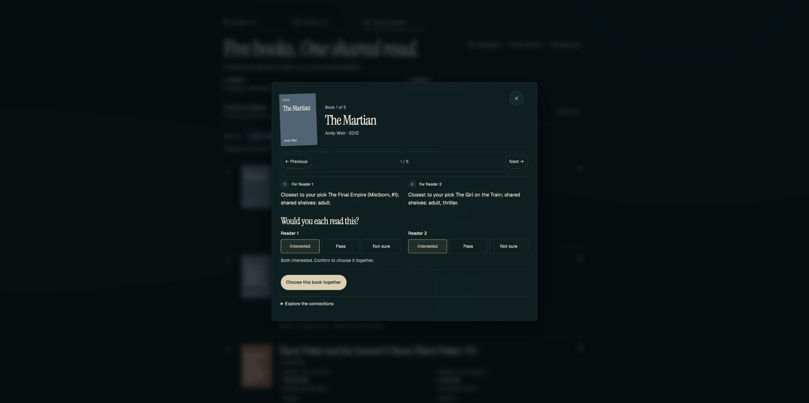

# Version A with the real Goodreads model

Verified October 18, 2026 (ET) on Jenny's computer using **Docker Compose**, with the frontend and backend in separate containers. Both containers were healthy. The existing public website was not updated by this run.

| Loaded model | Evidence |
| --- | --- |
| 5,000 books; `b2-als-gr-317756d1a1ad` | Live `/api/health` |
| Data version `gr-317756d1a1ad` | Mounted `meta.json`; this backend's health response has no data-version field |
| B2 implicit ALS | Export metadata; no training rerun in this check |
| App source | `2dd7120a8783da32b0a38faa203f8d1fc94135c0` |
| Model pointer source | PR #7, `0a02704060a31320b52da00076d8d12b5d986322` |

Only `data/artifacts.dvc` was downloaded (about 8 MB). Its `current` export was mounted **read-only**. No backend, model or pipeline code was changed.

## Checked flow

1. Searched real titles and selected five books per reader. Moving to Reader 2 cleared the search and kept Reader 1's picks.
2. Received five recommendations in both ranking modes. Opened separate reader reasons and a galaxy node. The map displayed 15 nodes using API coordinates.
3. Marked both readers Interested in *The Martian*, chose it together, then explicitly sent anonymous feedback. The UI confirmed success; the test container stored exactly one event with the real model version.
4. A search with no matches retained both sets of picks. Stopping the test backend retained all ten picks and the previous shortlist. After restart, **Try again** completed the requested average ranking without a page reload.

The API probe also checked reason ownership, shared shelves, aggregation scores and an unknown-book-ID response. **41 frontend tests**, the four-route release check and both Docker image builds passed before this run.

Screenshots: [lower reader match](least-misery.jpg) · [average](average.jpg) · [feedback saved](feedback-sent.jpg) · [galaxy](galaxy.jpg) · [no search matches](empty-search.jpg) · [API unavailable](api-unavailable.jpg) · [recovered](recovered.jpg).

Records: [inputs and mapped API outputs](api-check.json) · [versions, hashes, container status and feedback event](verification.json). These selections are test inputs, not personal reading-history records.

## Repeat the check

Follow the [trained-model run instructions](../../../backend-integration.md#existing-trained-model-export), then open `http://127.0.0.1:4176/a/?api=1`. Confirm `/api/health` reports the model above and 5,000 books. Google access to the team's DVC bucket is required to download the export.

## Limits and follow-up

- This proves local app integration with a trained export. It does not verify the full ingestion/training pipeline, recommendation quality, or public API hosting.
- Zero search matches were checked here. The empty recommendation shortlist check remains the separate [October 12 toy-data test](../).
- Source metadata needs review: *The Girl on the Train* (`41107568`) has year `1394`; *Chamber of Secrets* (`6231171`) has year `1988`. Those values are present in the export and API, and are rendered unchanged. No replacement dates were invented.

Codex assisted with the frontend changes and verification. The PR remains available for team review.
