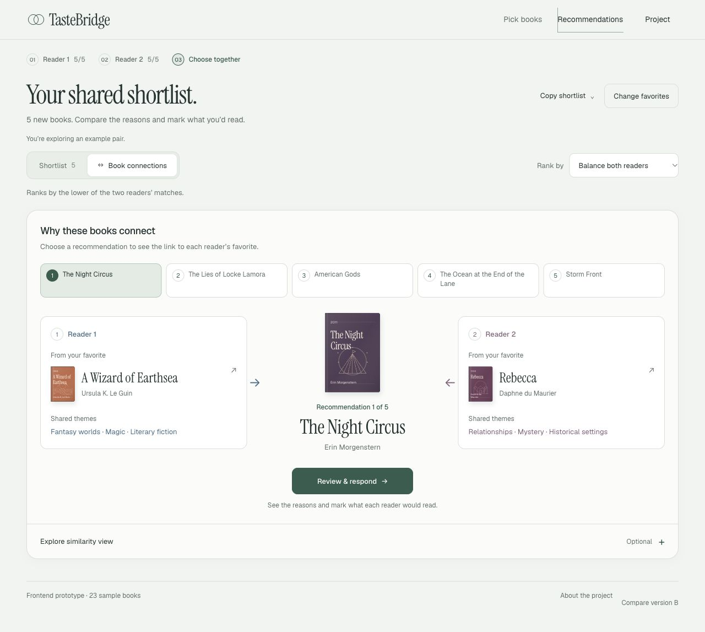
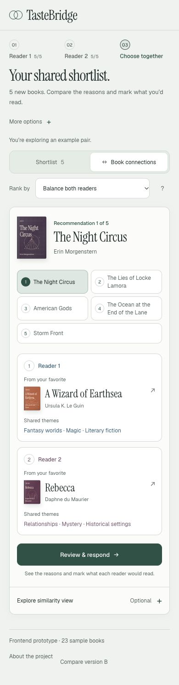
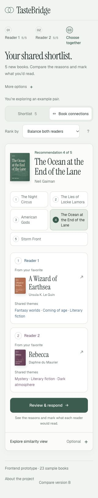
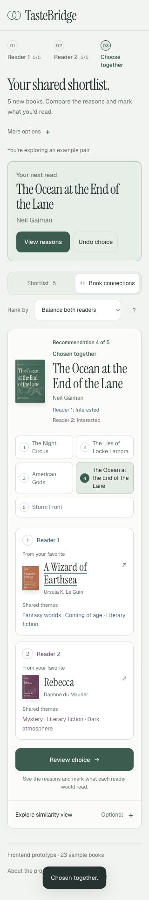

# Book connections UX review

November 4, 2026 · A release `20261104.3` · branch `jenny/ms3-ui-setup`.

An independent UX specialist reviewed the implementation and actual desktop, 390px and 320px screenshots. The final review found no remaining UX blocker for this local prototype.

## User goal → changes

| Usability problem | Current behavior |
| --- | --- |
| “Taste map” suggests geography while showing abstract points | The primary view is **Book connections**, a named diagram of the two readers’ reference books and the current recommendation |
| Users must interpret numbered dots before seeing a title or reason | Covers, titles and the returned shared themes are visible directly; all five recommendations have named selection controls |
| Decorative ellipses and radial lines imply unsupported boundaries or clusters | Removed; the optional projection retains only book positions and actual explanation-reference paths |
| Mobile users reach the current book too late | Current cover/title comes before the five-book navigator; at 390px the title moved from about y814 to y498 |
| Copy controls, ranking explanation and an empty decision bar crowd the task | Mobile secondary actions use More options; ranking has an inline help disclosure; the decision banner appears when there is a meaningful joint-interest or choice state |
| Closing a detail dialog could focus a hidden projection node | Focus returns to the visible relation action or title control |
| A static relation action fails to reflect responses and confirmation | Reader responses stay visible; the action changes from Review & respond to Review & choose, then Review choice after explicit confirmation |

The backend's coordinates are a two-dimensional book-similarity projection; the offline fixture projects theme vectors. There are no geographic locations. The schematic reference diagram uses the actual `seedId`, `seedTitle` and `reason.tags`; it does not generate new evidence or use its arrangement as a score. The original projection remains available under **Explore similarity view**, with a visible explanation before the plot. Ranking, returned scores and API coordinate contracts are unchanged.

The refined daylight palette, original jackets, Instrument Serif / Geist hierarchy and reduced-motion rules remain in place. Version B and the project-scope source page remain unchanged.

## Actual screens

| 390px phone | 320px long title | Explicit joint choice at 320px |
| --- | --- | --- |
|  |  |  |

## Verification

**80 tests passed, 0 failed, 0 skipped.** [Final TAP report](connections-ux-20261104/frontend-tests.tap). All four generated routes passed inline-JavaScript, metadata and navigation verification. `git diff --check` passes.

Final browser checks used the actual frontend, the 23-book independent demo and the real local 52-book sample API. [Recorded browser observations](connections-ux-20261104/final-browser-checks.json).

| Check | Observed result |
| --- | --- |
| Select all five offline recommendations | Current title, ordinal, separate references and shared themes update together; one title remains selected |
| 320px long title | The Ocean at the End of the Lane wraps; page scroll width remains 320px |
| Two Interested responses | Both responses show; Review & choose is available; no Chosen together claim |
| Explicit confirmation | Chosen together and Review choice appear with both reader responses |
| Change Reader 2 to Pass | Shared choice and confirmed banner disappear; Pass and Review & respond show |
| Close reference or recommendation details | Focus returns to a visible relation control |
| Keyboard Left/Right between result tabs | Changes the visible view while keeping the selected recommendation and responses |
| Connected API long title at 320px | Mr. Penumbra's 24-Hour Bookstore, The Name of the Wind and Rebecca appear correctly; scroll width remains 320px |
| Optional connected projection | All 15 book nodes render; no decorative orbit/cluster elements; 125% zoom and Fit all work |
| Browser console | No warning/error entries observed in either final test tab |

The last status patch was absent after the interrupted session. It was applied after reconnection, rebuilt, included in the 80-test run, and exercised through confirmation and revocation in the browser. The UX specialist independently reviewed the final narrow-screen and chosen-state screenshots.

## Review without a running server

Rebuild the self-contained A/B files from `frontend/prototype` with `node scripts/build-prototype.mjs`; open `.prototype-build/TasteBridge-Prototype-A.html`, then choose **Try a sample pair → Book connections**. Keep the B sibling for comparison navigation. The Project page and API mode need HTTP hosting. An owner-specific preview ZIP was delivered separately.

The separate [hosted review Site](https://tastebridge-reading-desk-20261104.landenini.chatgpt.site) is currently owner-private; sharing scope is awaiting confirmation. It is a static UX review and does not serve the model API. [Access and reproduction](preview-access-20261104.md).

The ZIP's bytes, inline scripts, release marker and local project links were checked. The browser policy still prevents automated `file://` rendering verification; actual interaction checks used the equivalent generated application over loopback HTTP. Earlier Chrome control and Terminal-app restrictions were not retried or bypassed. The HTTP test server is temporary; it is not the durable delivery route. [Access diagnosis](preview-access-20261104.md).

No push, deployment, public hosting, team message or permission change occurred. The offline preview is a 23-book fixture; the connected checks use a 52-book toy model. Neither establishes trained-model quality or production readiness.
