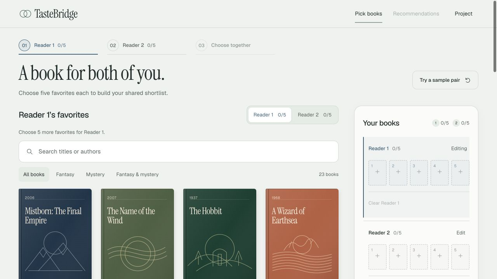
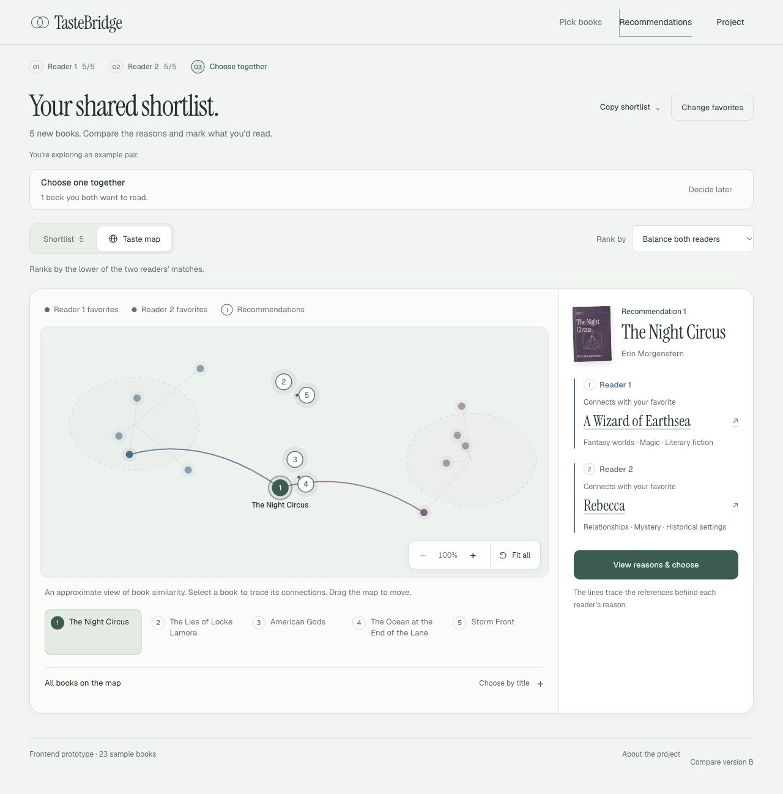
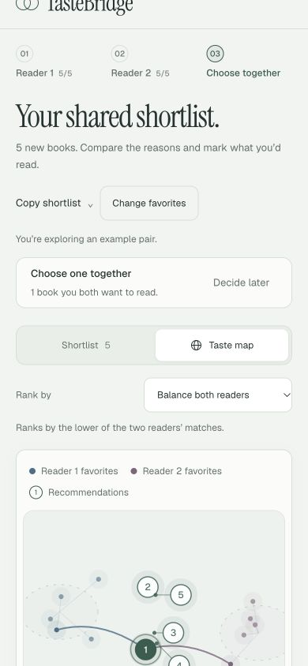
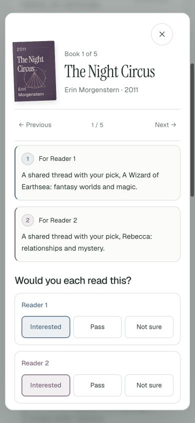
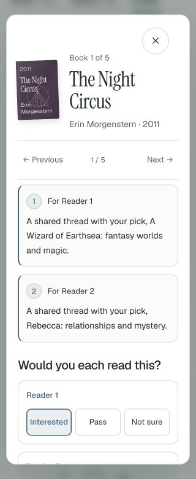
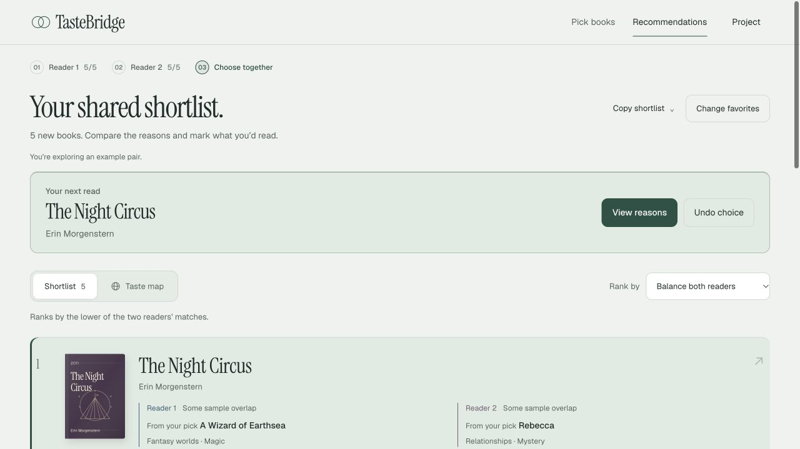
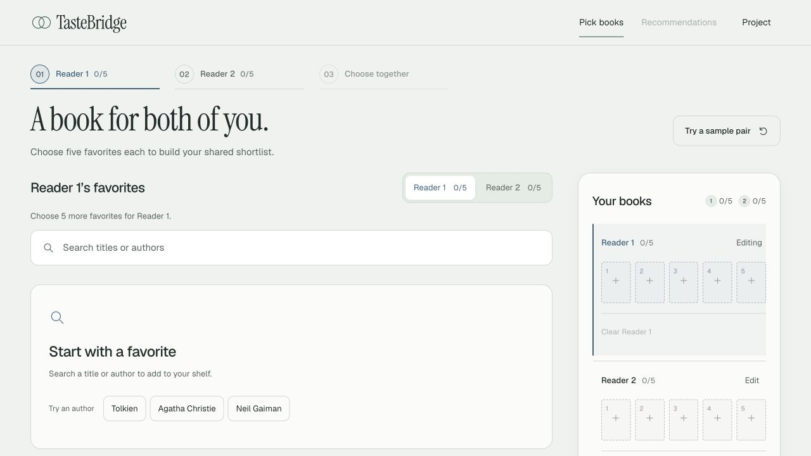
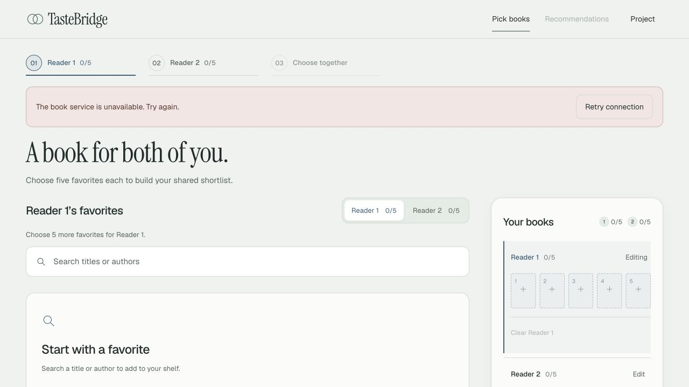

# Reading Desk design review

November 4, 2026 · A release `20261104.2` · branch `jenny/ms3-ui-setup`.

The later [Book connections UX review](connections-ux-20261104.md) records the current release `20261104.3`, its clearer relation view and final narrow-screen checks. This document retains the visual-system decisions and earlier design evidence.

A dedicated designer implemented the visual refresh; a separate designer reviewed screenshots of the actual application. Both accepted the final selection, map, detail, response, confirmation and recovery states after two correction passes.

## Design decisions

| Element | Current treatment | Purpose |
| --- | --- | --- |
| Canvas and surfaces | Mist `#F1F4F1`, white, ink `#223331` | Quiet reading surface; original book jackets carry the strongest color |
| Shared action | Spruce `#315D4F` | Consistent next step and joint-choice identity |
| Reader identities | Denim `#466E87`, mulberry `#82647C` | Distinguish separate reader evidence, votes and map clusters; text labels remain present |
| Typography | Instrument Serif for main headings and book titles; Geist for UI and body | Editorial book identity with clear functional hierarchy |
| Components | Consistent borders, 8/12/20px radii by role, restrained shadows | Controls, panels and dialogs follow the same visual grammar |
| Motion | Small book lift/placement, 220ms dialog entry, directional paging and shared-choice feedback | Make actions legible without repeated page-entry animation |

The design uses the requested restrained UI taste while retaining TasteBridge's overlapping-circle mark, book illustrations and two-reader concept. No packages or remote font dependencies were added.

## Actual review and corrections

| Finding from rendered application | Final correction |
| --- | --- |
| Too much desktop space before selectable books | First cover starts at y487, compared with y557 in the original screen |
| Replacement dialog buttons crowded together | Explicit 10px action gap and narrow-screen wrapping |
| Legacy dark styles made reader numerals hard to read | Reader-colored numerals on pale matching fills |
| A disabled detail action retained the old dark fill | Specific daylight disabled state |
| Generic hover styling muted a selected reader response | Selected state keeps its reader color during hover and focus |
| Comparison link competed with the main task | Compare version B sits with the project link in the footer |

The independent review found no remaining visual issue that blocks local review. The phone dialog keeps space for its close button; its content scrolls vertically at narrow widths.

## Screenshots

| Selection | Map |
| --- | --- |
|  |  |

| Phone map | Reader responses | 320px details |
| --- | --- | --- |
|  |  |  |

| Joint choice | Connected catalogue | Error recovery |
| --- | --- | --- |
|  |  |  |

## Verification

**75 tests passed, 0 failed, 0 skipped.** [TAP report](design-review-20261104/frontend-tests.tap). The final CSS hover correction was subsequently rebuilt; all four generated routes passed JavaScript, metadata and navigation verification. No warning/error entries were captured in the main preview's console. `git diff --check` passes.

| Final visual check | Viewport width | Page scroll width |
| --- | ---: | ---: |
| Desktop joint choice | 1280 | 1280 |
| Desktop API error | 1280 | 1280 |
| Tablet selection and detail | 768 | 768 |
| Phone map and detail | 390 | 390 |
| Narrow selection, map and detail | 320 | 320 |

The 320px dialog is 300px wide. Screenshots and interactions were checked in the in-app browser. The earlier [functional review](ux-refinement-20261104.md) records search, favorites, map navigation, zoom, keyboard tabs, ranking, reversible joint choice and focus recovery.

Contrast checks on the palette give spruce 6.75:1, denim 4.93:1 and mulberry 4.66:1 against the mist canvas. Actual reader badges use full reader colors on pale matching fills. Error text uses `rgb(99,62,53)` on `rgb(244,233,231)`. Reader labels and numbers accompany color.

Source review confirms `prefers-reduced-motion: reduce` and `.reduce-motion` disable animations and smooth scrolling, reduce transitions, and suppress book transforms. New entry/confirmation animations are gated by `no-preference`. This verifies the source rules; an OS reduced-motion setting was not changed or emulated. Keyboard focus and reversible-choice behavior have regression coverage; this is not a complete accessibility audit.

## Local review

- [Offline example](http://127.0.0.1:4180/a/?api=0): choose **Try a sample pair**, then **Taste map**.
- [Connected sample](http://127.0.0.1:4180/a/?api=1): actual local API with 52 bundled books.

The main preview was healthy during design verification but stopped after task completion. A later detached launch also failed to persist. The separate error-test server was stopped after capture. The follow-up delivered a complete offline folder and ZIP, and opened A in Chrome; see [preview access](preview-access-20261104.md) for the current route, exact tool blockers and manual server restart instructions. The HTTP links above require a running server.

The review was developed in an isolated copy; the original development checkout was left unchanged. No team GitHub push or model deployment occurred during the design pass. Version B and the project-scope page remain unchanged. Backend ranking and coordinate contracts are preserved.

Docker's configured daemon is unavailable and the trained 5,000-work export is absent. These checks establish UI behavior against the bundled sample API; they do not establish trained-model quality or production readiness.
