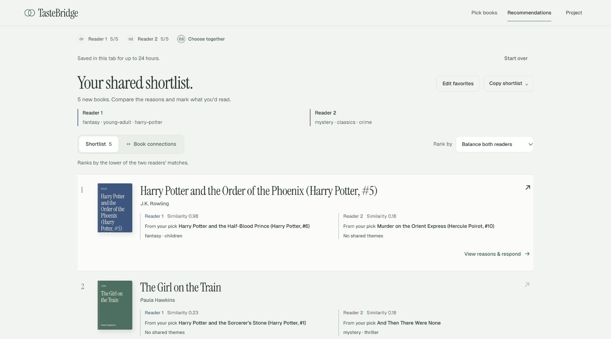
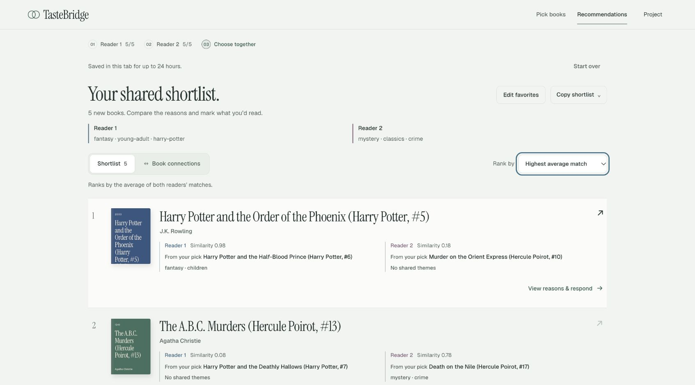
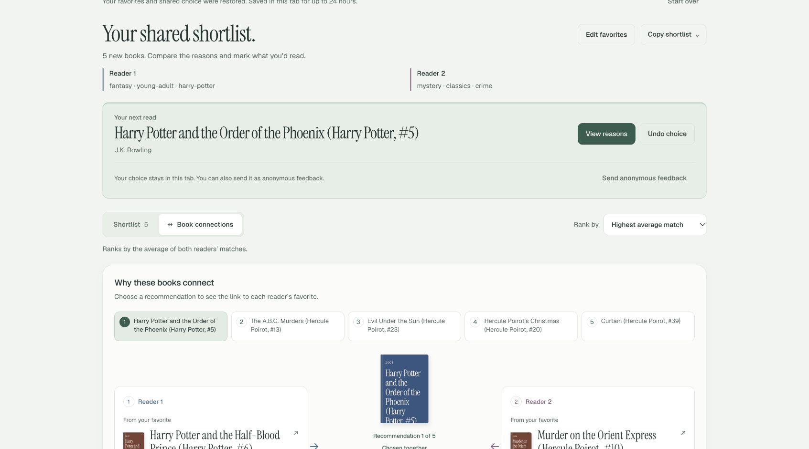

# Deployed TasteBridge verification, November 11, 2026

Service: https://tastebridge-staging-fbii3egyuq-uc.a.run.app  
Ready revision: `tastebridge-staging-00002-vzn` (100% traffic).  
Deployed source: `5184a6c836b2988f18f1f9586bb0ebf1a43f2731`.

- [Deployment and image/model identity](deployment-summary.json)
- [Full live contract smoke](live-smoke.json)
- [Actual curl checks and prediction outputs](curl-checks.json)
- [Selected actual Cloud Logging records](cloud-logs.json)
- [Browser actions, transport and limits](browser-checks.json)

## Real deployed prediction screenshots

These were captured while Chrome called the cloud service through Google's authenticated localhost proxy. They are not screenshots of a local model server or the static public prototype. The URL/revision and exact model identity are recorded above; the independently authenticated curl checks and revision-linked request logs corroborate the cloud invocation.

[Narrow-layout screenshot](live-narrow-connections.jpg): actual viewport 693px, no horizontal overflow. This capture establishes the 693px layout only.

## Access and monitoring

Anonymous `/api/health` returned 403; no IAM or invocation settings were changed. An already authorized caller can use `gcloud run services proxy tastebridge-staging --project=tastebridge-511403 --region=us-central1 --port=8080`, then open `http://localhost:8080/a/?api=1`. The teaching-staff account's own access still needs confirmation.

The cloud logs contain successful `/api/recommend` requests and one explicit demo feedback event at `2026-11-11T03:02:24.696040Z` for book `2809203`, vote `would_read`, model `b2-als-gr-317756d1a1ad`. This is functional logging evidence, not a production latency benchmark, permanent feedback database, or model-drift monitor. Log retention/exclusion configuration was not audited or changed.

The bundle contains actual machine-readable curl responses and real deployed browser prediction screenshots. `/frontend/health` and all final smoke assertions pass. Serving evidence does not establish a new training/pipeline run or Canvas submission.
