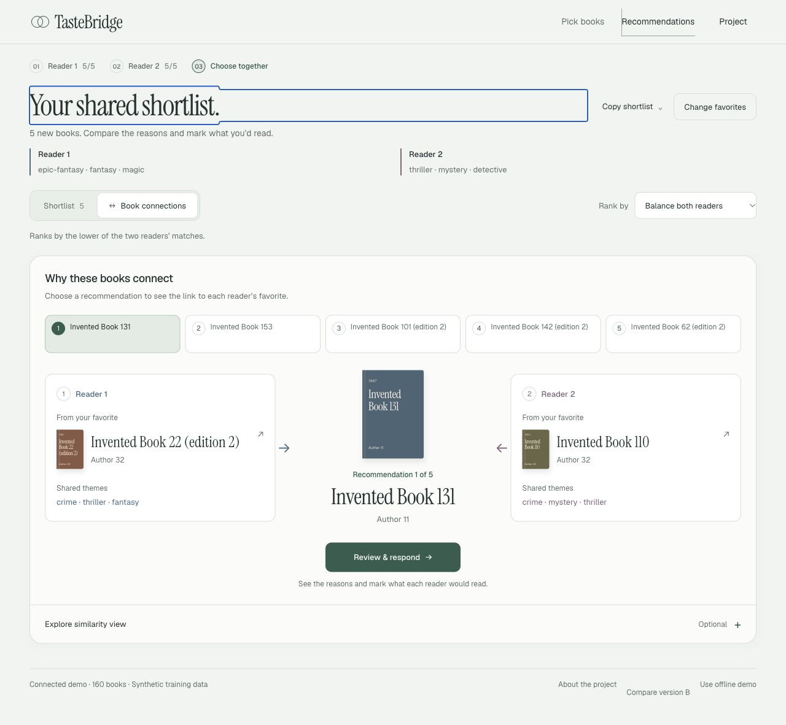

# Local trained-model evidence

November 4, 2026. **Synthetic input, local execution. No cloud or Goodreads-quality claim.**

The existing B2 exporter actually fitted this model. This differs from the fixed 52-book fixture: the new model has **160 learned book vectors**, using **9,072 processed interactions from 395 retained synthetic readers**. The UI identifies the input as synthetic training data.

```text
invented raw files   preprocessor    B2 export       real API + relay    Reading Desk
       │                  │             │                 │                 │
       └──────────────────┴─────────────┴─────────────────┴─────────────────┘
                   source hashes + parameters + logs + response checks

held-out evaluator: 316 train / 40 tune / 39 test readers
                    23 eligible test readers, 20 simulated pairs
```

## What ran

| Evidence | Actual result |
| --- | --- |
| [Run A](runs/run-a/run.json) / [Run B](runs/run-b/run.json) | Both complete local chains passed from clean source `e8a31285afc12b052b7f11f5b440358f89fa1b42` |
| [Two-run comparison](runs/reproducibility.json) | Five raw gzip files, two processed tables, vectors, coordinates, metric CSV and both full-shelf API rankings match in this environment |
| [Training metadata](runs/run-a/export-meta.json) | Seed 42, 16 factors, 8 iterations, regularization 50, alpha 20; model `b2-als-synthetic-244f05111efd` |
| [Held-out configuration](runs/run-a/evaluation-config.json) / [metrics](runs/run-a/evaluation-summary.csv) | B0/B1/B2, both served aggregation rules, separate training/test readers |
| [HTTP contract](runs/run-a/api-check.json) / [actual request/responses](runs/run-a/api-examples.json) | Model identity/count, search/details, ranking, seed exclusion, references, projection consistency and private-route checks pass |
| [Backend request log](runs/run-a/backend.log) / [frontend relay log](runs/run-a/frontend.log) | Actual local requests; no external feedback submitted |
| [Frontend suite](frontend-tests.tap) | 82 passed |
| [Preprocessing suite](preprocess-tests.txt) | 122 passed, including clock- and destination-independent synthetic gzip hashes |
| [Integration/evidence tools](integration-tests.txt) | 14 passed, including rejecting changed vectors, failed runs and operator data in the synthetic evidence collector |

The unchanged [backend suite](../../local-continuation-20261104/backend-tests.txt) and [evaluation suite](../../local-continuation-20261104/evaluation-tests.txt) passed earlier the same day: 77 and 54 tests. The complete current training/HTTP integration then ran twice.

Only selected metadata, aggregate synthetic metrics and logs are copied here. The ignored run folders retain generated input and learned artifacts. This folder contains no trained weights or real reader histories. Run A was still serving local review when its metadata snapshot was captured; its URL and `services_stopped` value describe that capture, not a permanent hosted service.

The first attempt's training/evaluation stages completed, but the new verifier rejected valid independently rounded four-decimal API values. The verifier now uses the documented response precision. The failed attempt remains under the ignored run directory; the two successful runs above are separate executions, not relabeled failures.

## Actual UI checks

The frontend at A `20261104.5` loaded the newly exported catalogue and generated five recommendations from ten actual export IDs. At 320 × 640:

- Both Interested responses enabled an explicit choice. Confirmation showed Chosen together.
- Reader 2 changing to Pass revoked the choice. Closing details focused the visible Review & respond action.
- Average ranking returned a different five-title list.
- The optional projection rendered 15 nodes with no decorative orbits. Page width stayed 320px.
- The footer said **Connected demo · 160 books · Synthetic training data**. No warning/error console entries appeared.



Chrome's extension API and native capture limitations remain documented in the [continuation report](../../local-continuation-20261104.md). Actual interaction checks used supported local HTTP in the in-app browser; Chrome verification is not claimed. No prior Terminal-app or file-URL restriction was retried.

## Presentation and remaining evidence

The [12-slide review deck](../../presentation/TasteBridge-MS3-review.pptx) has a 15-minute plan and sources in speaker notes. [Manuscript](../../presentation-source.md), [rehearsal](../../rehearsal.md) and [validation](presentation-qa/) accompany it. Package and geometry checks pass. All 12 DrawingML browser-review slides have no measured text/table overflow. Keynote application control timed out, so native PowerPoint/Keynote rendering remains unverified.

The [official MS3 requirements](https://harvard-iacs.github.io/2026-AC215/milestone3/) still require a real tracked serverless run, an approved automated cloud workflow/equivalent, deployed model/API, production logging and final submission. The [evidence index](../index.json) remains incomplete. [Reproduction commands](../../reproduce.md) and [operator handoff](../../operator-handoff.md).
