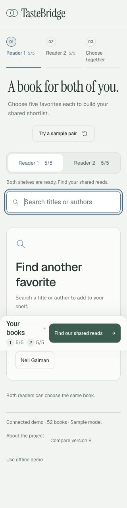
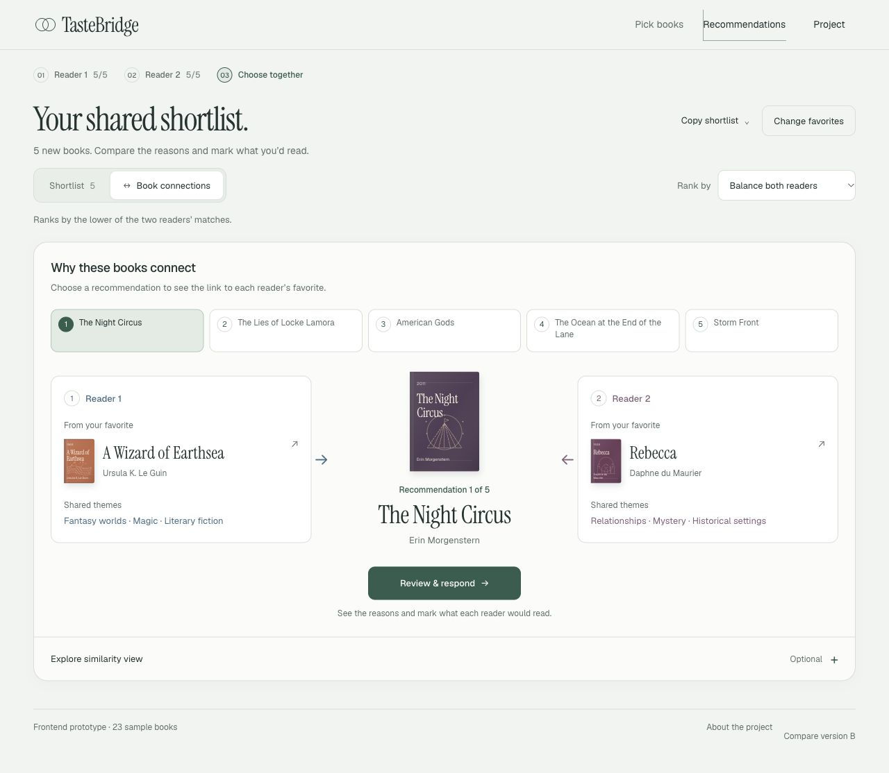

# Local continuation: search recovery and MS3 recheck

November 4, 2026 · local A `20261104.4` · `jenny/ms3-readiness`.

## Changes and actual checks

During sample-pair loading, the search field and reader controls were disabled, but author shortcuts remained clickable. Search shortcuts and recovery controls now follow the same busy state, including when the catalogue redraws. Pick books remains available to cancel/recover.

The clear-search button and the two empty-state recovery paths now share cancellation and reset behavior: cancel the request lane and debounce timer, clear results/error/loading state, redraw the catalogue and focus search. Clearing the query preserves its category; Browse sample books also resets the category. A regression test resolves a cancelled old search after clearing and verifies it cannot redraw stale results or change either reader's shelf.

Actual local HTTP checks in the in-app browser used the 52-book sample API at 320 × 640:

| Flow | Observed result |
| --- | --- |
| Sample pair → Book connections → fifth recommendation | Current title updates and remains visible; no horizontal overflow |
| Return to Reader 1 → nonexistent title → Clear search | Empty query, catalogue restored, `aria-busy=false`, search focused; both shelves remain 5/5 |
| Final page width | `scrollWidth=320`, `innerWidth=320` |

After recovery, the Tolkien shortcut returned the two matching titles. Removing and adding The Hobbit changed Reader 1 from 5/5 → 4/5 → 5/5; Reader 2 stayed 5/5 throughout. The final clear action again restored search focus and the catalogue.



The existing relationship layout, ranking and shared-choice behavior are retained. B and the project overview remain byte-for-byte unchanged. [Earlier actual visual evidence](connections-ux-20261104.md).

The final offline review tab was loaded over supported loopback HTTP with the example shelves and Book connections selected. It is self-contained after loading: selecting books and responding do not need the API. Refresh and navigation to another route still require the local HTTP server. The browser viewport override was reset and no warning/error console entries were observed in the final tab.



## Verification

| Check | Current result |
| --- | --- |
| [Frontend regression report](local-continuation-20261104/frontend-tests.txt) | 81 passed, 0 failed/skipped |
| Four generated routes | JavaScript, release metadata, root/A identity and navigation pass |
| [Backend](local-continuation-20261104/backend-tests.txt) | 77 passed |
| [Evaluation](local-continuation-20261104/evaluation-tests.txt) | 54 passed; 2 fixed-seed UMAP parallelism warnings |
| [Readiness/configuration tests](local-continuation-20261104/readiness-tests.txt) | 4 passed |
| [Evidence completeness](local-continuation-20261104/evidence-check.json) | Intentionally fails: 7 unclosed items, no manifest/path errors |

## Chrome and review access

Chrome's extension API returned `Cannot read properties of undefined (reading 'timeoutMs')`. Native Chrome control opened the local app in the **AC215 review** tab group and confirmed its title/address; the server recorded the page and API-health requests. The native screenshot remained blank and the page body was absent from accessibility output, so Chrome interaction and visual QA are **not** claimed. A later attempt to leave the updated offline example in Chrome was interrupted when the user changed the app. Control stopped; that navigation is not claimed as completed. The in-app browser provided the independent local flow checks above. No Terminal-app or `file://` restriction was retried or bypassed.

The loopback preview is `http://127.0.0.1:4180/a/?api=1` while the local launcher is running. It is not a durable hosted URL. To reproduce, keep this command running from `frontend/prototype`:

```sh
TASTEBRIDGE_UI_PORT=4180 TASTEBRIDGE_API_PORT=9020 node scripts/dev.mjs
```

This restricted task used a checkout-local `UV_CACHE_DIR`, because the default home cache was not writable. Runtime execution required the normal tool approval to bind the two loopback ports; the approved launcher did not change any security or system-service settings.

The [existing hosted review Site](https://tastebridge-reading-desk-20261104.landenini.chatgpt.site) remains release `20261104.3`. It was not republished and its sharing was not changed in this continuation. The earlier owner-private login limitation remains recorded in [the access report](preview-access-20261104.md).

## MS3 state, checked again

The [official MS3 instructions](https://harvard-iacs.github.io/2026-AC215/milestone3/) still require tracked reproducible serverless training, deployed model/API, an automated workflow, production logging and tested/documented predictions. Submission is the full commit on `milestone3` by November 12, 10pm ET, plus the 15-minute TF slide presentation.

A fresh read-only remote inventory still has no `milestone3` branch. Remote `main` and `milestone2` remain `fccfbac53a96de18b71ca1c3f668a6bea115e51e`; cloud-staging remains `df64cdbe0ac3dff72cda9bf64f251d1e89973e1b`. The Colima Docker socket and local trained export are absent; `gcloud` is not on PATH. Cloud executions, live service, production logs, slides and Canvas submission remain unverified. See the [runbook](README.md) for the evidence and operator handoff.

No GitHub push, merge, Site publication, sharing change, cloud deployment or external message was performed in this continuation.
