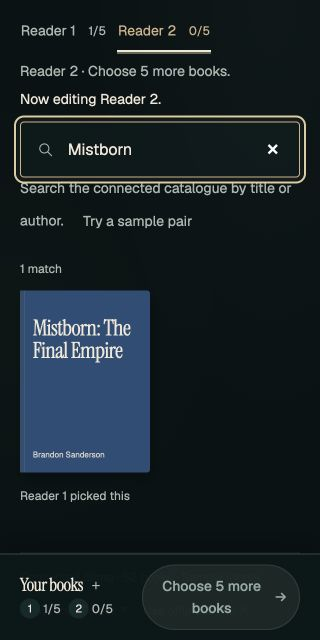
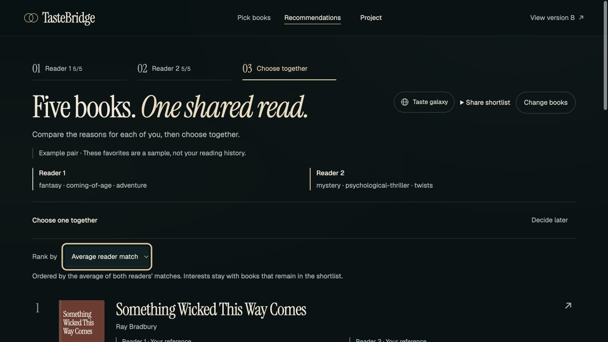

# M3 readiness and local verification

Checked November 4, 2026. Local setup and frontend continuation on `jenny/ms3-ui-setup`, based on `fccfbac53a96de18b71ca1c3f668a6bea115e51e`.

This is the initial setup snapshot. The [MS3 runbook](README.md) and [Book connections review](connections-ux-20261104.md) record the current branch, requirements and 80-test frontend result. The intermediate [UI refinement](ux-refinement-20261104.md) and [design review](design-review-20261104.md) retain the earlier visual passes.

## Course requirements → evidence

[Official M3 requirements](https://harvard-iacs.github.io/2026-AC215/milestone3/) were checked directly. Hybrid-model directions in the MS2 notes remain proposals; M3 does not require replacing the model already served.

| Requirement | Evidence now | Still to verify |
| --- | --- | --- |
| Experiment tracking and reproducible serverless training | [B2 training and evaluation records](../ms2/models/) | Tracked run and Vertex AI training run, or documented equivalents |
| Serverless model/API deployment | Backend container and separate `frontend/cloud-staging` branch | Reachable service, redeploy instructions and response screenshot |
| Automated ML workflow | [Local Compose pipeline evidence](../ms2/datapipeline/evidence/) | Vertex AI pipeline or documented equivalent |
| Production monitoring | Request logging in the local API and frontend relay | Deployed logs and access instructions |
| Documented, tested prediction API | [Backend SPEC](../../src/backend/SPEC.md), existing tests and [MS2 real-model evidence](../ms2/frontend-api/real-model-20261018/) | Run against the deployed service |
| Submission | Remote `milestone2` and `main` both at `fccfbac` | `milestone3` branch, README changes/evidence, full commit hash on Canvas by Nov 12, 10pm ET; slides for the 15-minute TF presentation |

GitHub was checked read-only: remote `main` still matches this baseline; the only open PR is [#11, architecture diagrams](https://github.com/cathyliu0510/AC215_TasteBridge/pull/11). No remote `milestone3` branch was listed. This does not establish teammates' unpushed progress or Canvas status. No team number was found in the repository or proposal.

## Changes since MS2

- Added a read-only prerequisite check for Node, uv, backend source, port configuration and local artifact files. The launcher uses the same configuration validation before build/startup.
- Isolated standalone host configuration from an ambient shell `HOST`. Docker now explicitly sets `TASTEBRIDGE_HOST=0.0.0.0` to match the server.
- Made startup cancellation abort API health checks and retry waits. A backend exit now closes the frontend; cancelling during frontend binding cannot report a connected app.
- Preserved the earlier reader shelf, empty-slot and focus styling. On a phone, editing either reader now closes the fixed shelf and brings search into view, including when that reader is already active.
- Rebuilt A and its root alias from source; B and the project page remain unchanged.

## Verified locally

Run from `frontend/prototype`:

```sh
node scripts/check-setup.mjs --json
node scripts/build-prototype.mjs
node scripts/verify-release.mjs
node --test tools/verify-*.mjs
node scripts/dev.mjs
```

The original 48 frontend tests passed before continuation. At this setup checkpoint, **55 tests passed**, including port/argument/host regressions and four launcher lifecycle cases. [Checkpoint TAP report](local-ui-20261104/frontend-tests.tap). The four-route build verification and `git diff --check` also passed. Later UX work brought the suite to 80 tests; see the current report linked above.

The connected launcher was exercised offline using existing uv-cached packages, with UI port 4180 and API port 9020. It started the bundled model `sample-shelf-toy-v1`, data `hand-curated-sample-52`, with 52 books. A final launch with the lifecycle fixes returned [this API health response](local-ui-20261104/sample-health.json) through the frontend relay and shut down cleanly on Ctrl-C. Temporary preview services were stopped after verification. Browser checks covered:

| Check | Result |
| --- | --- |
| Desktop 1280px, phones 390px and 320px | No page horizontal overflow in inspected views |
| Offline five-book selection and Reader 2 handoff | First reader's picks kept; search receives focus |
| Expanded shelf → Edit at 320 × 640 | Shelf closes; search is focused and visible above the fixed footer |
| Connected title search and favorite selection | Search returns Mistborn; pick appears in Reader 1's shelf |
| Connected reader switch | Existing query kept; reader identity updates; search remains visible |
| Sample-pair recommendations | Five results, separate references and model similarities |
| Both Interested → explicit shared choice | Choice confirmed locally; no feedback was submitted |
| Switching to average ranking | Removed choice revoked with an explanatory message |
| Browser console | No warning/error entries observed |





## Runtime limits

- Docker verification could not run because the configured Colima Docker daemon socket was absent. The host configuration regression is covered by a test; actual container reachability remains unverified in this session.
- The trained export at `data/artifacts/current` is absent in this checkout. Local browser verification used the 52-book sample, not the 5,000-work model.
- Cloud jobs, deployment, credentials, permissions and submissions were not changed. No push or external message was made.
