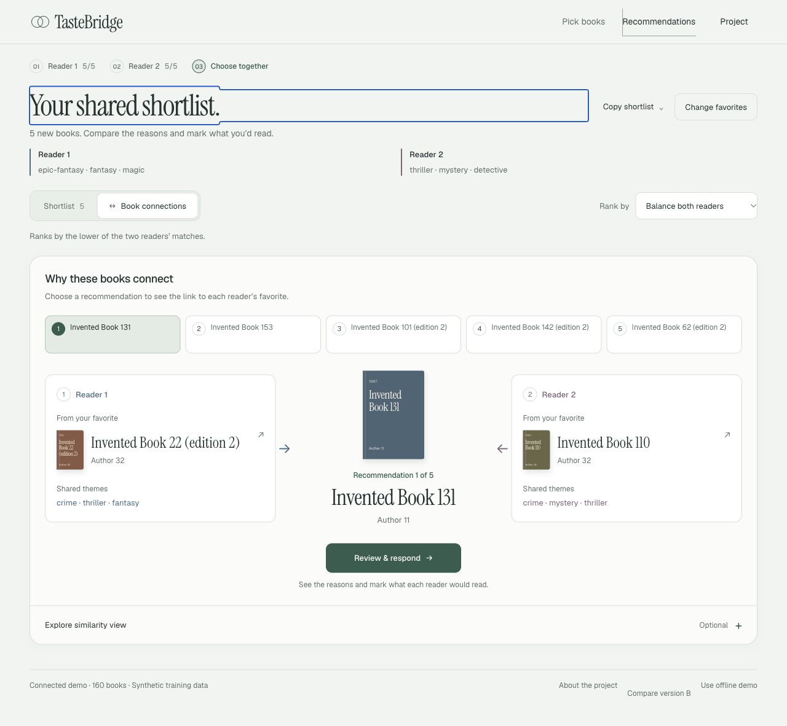

# TasteBridge

::: notes
Timing: 45 seconds.

Local integration review, November 4, 2026. Cloud execution, deployment and monitoring remain unverified. This deck is a review draft, not a completed MS3 submission. The existing algorithm and model modules come from the team's MS2 work. This continuation adds orchestration, reproducibility checks, contract verification and frontend provenance. Sources: docs/ms3/README.md; official MS3 https://harvard-iacs.github.io/2026-AC215/milestone3/.
:::

# One export drives the API and interface

::: notes
Timing: 75 seconds.

Trace processed tables through evaluation.export to four files, then app.artifacts and the frontend relay. The served model reads the same versioned files together. The optional text-embedding index is a separate workflow, not consumed by B2 serving. Sources: docker-compose.yml; src/evaluation/evaluation/export.py; src/backend/app/artifacts.py; frontend/prototype/scripts/serve.mjs.
:::

# Two clean runs reproduce the same outputs

::: notes
Timing: 75 seconds.

Both saved runs use source commit e8a31285afc12b052b7f11f5b440358f89fa1b42. Both working trees were clean at run start. Hash comparison covers five generated gzip files, two processed tables, item vectors, coordinates and summary.csv. Full-shelf API rankings also match. This establishes same-environment reproducibility, not cross-platform bitwise equality. Sources: docs/ms3/evidence/local-integration-20261104/runs/reproducibility.json; run-a/run.json; run-b/run.json. Initial run failed because the new verifier compared four-decimal API output at excessive precision; e8a3128 corrected the verifier and retained the failed run locally.
:::

# Evaluation and serving use separate fits

::: notes
Timing: 90 seconds.

The exporter fits all retained synthetic users for serving. The evaluator independently fits training users only, then evaluates disjoint held-out users. There are 316 training, 40 tuning and 39 test users; 23 test readers have enough catalogue likes for simulated pairs. Favorites are excluded from ranking. The local smoke uses 16 factors and 8 iterations. The previous tuned MS2 configuration remains 128 factors and 15 iterations. No model replacement or quality improvement is claimed. Sources: src/evaluation/evaluation/run.py; export.py; als.py; saved evaluation-config.json and export-meta.json.
:::

# The evaluator records both ranking rules

::: notes
Timing: 75 seconds.

All numbers on this slide are from invented input and 20 simulated pairs. They verify metric generation and configuration coverage only. They do not rank models for Goodreads, and the local ALS smoke is not claimed to beat the baselines. Min-Recall@10 is the smaller of the two readers' hidden-like recalls. NDCG@10 averages the two readers' values. Source: saved evaluation-summary.csv and src/evaluation/evaluation/metrics.py.
:::

# The trained model reaches the Reading Desk

::: notes
Timing: 120 seconds.

Demonstration: open the actual model-backed UI, choose another recommendation, inspect each reader's reference, mark both Interested, explicitly choose, then change one reader to Pass. At 320px the choice is revoked, focus returns to Review & respond and no horizontal overflow appears. Switching to average changes the five titles. The footer explicitly identifies synthetic training data. Chrome remains limited by its extension error and blank native capture; actual interaction checks use supported local HTTP in the in-app browser. Sources: trained-ui-desktop.jpg, trained-choice-320.jpg, browser-checks.json; frontend/prototype/src/a/.
:::

# The API contract checks actual responses

::: notes
Timing: 75 seconds.

The JSON is the actual five-seed request saved in api-examples.json. The verifier uses two known catalogue IDs for the minimal endpoint check and additionally records full-shelf responses. It checks signed finite similarities and four-decimal serialization tolerance, correct aggregation, unique non-seed results, reader-specific reasons, matching projection IDs/positions, model identity and private-route isolation. It sends no feedback. Sources: deploy/cloud-run/smoke.py; tools/verify_local_integration.py; saved api-check.json and api-examples.json.
:::

# Tests cover each integration boundary

::: notes
Timing: 60 seconds.

Frontend, preprocessing and integration checks were rerun for this continuation. The unchanged backend's 77 and evaluation's 54 tests passed earlier the same day and are retained with their reports. New end-to-end training and HTTP checks ran twice after that. Test counts are not cloud evidence. Sources: docs/ms3/evidence/local-integration-20261104 test reports; docs/ms3/local-continuation-20261104/ backend and evaluation reports.
:::

# Cloud Run preparation is ready for operator review

::: notes
Timing: 75 seconds.

This is the existing prepared Cloud Run design, not a deployed diagram. Frontend port 8080 reaches the internal API at 9000. Images keep the model private. Build and smoke require a Docker daemon and a real approved export, currently absent here. gcloud is also absent. The existing publish operator command uploads images and grants public invocation, so it requires separate explicit authorization; the course also permits teaching-staff access with an authentication arrangement discussed with the TF. Sources: deploy/cloud-run/deploy.py; Dockerfile.backend; README.md; historical verification.local.json. Historical Docker evidence is not a current live deployment check.
:::

# Production logging still needs cloud evidence

::: notes
Timing: 60 seconds.

The log excerpt is from the actual local trained-model run. Request logging records method, path, status and elapsed time. The values are examples, not a latency benchmark. Cloud Logging must still show the real service revision and an actual response/error or feedback event with access instructions. No external feedback was sent here. Sources: src/backend/app/main.py; saved backend.log; deploy/cloud-run/README.md.
:::

# MS3 evidence still has cloud requirements

::: notes
Timing: 75 seconds.

The official rubric asks for at least one tracked reproducible serverless training run, an automated ML workflow, deployed model/API with staff access, basic production logging, documented/tested API, code/README/screenshots and a 15-minute presentation. Local automation and logs do not replace the cloud items. All unverified cells remain explicit in the evidence index. Source: https://harvard-iacs.github.io/2026-AC215/milestone3/ and docs/ms3/evidence/index.json.
:::

# The remaining handoff has three gates

::: notes
Timing: 75 seconds.

First confirm the team's chosen tracking and cloud workflow and any prior cloud executions. Then the authorized operator collects real run, service and log evidence using the approved data and existing deployment package. Finally review the integrated branch, reconcile architecture PR 11, and have the authorized maintainer create/update milestone3 and submit its full hash on Canvas by November 12, 10pm ET. Security review has denied pushing this branch; no bypass or alternate remote publishing is authorized. This deck's placeholders require replacement before the graded presentation. Sources: docs/ms3/README.md; reproduce.md; official rubric.
:::
