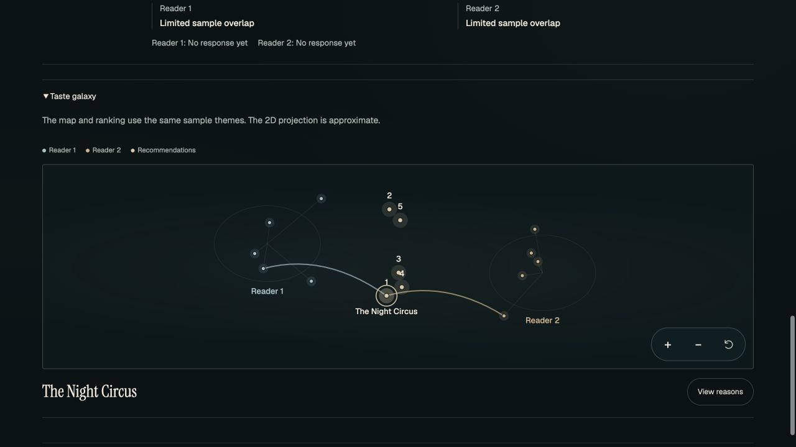
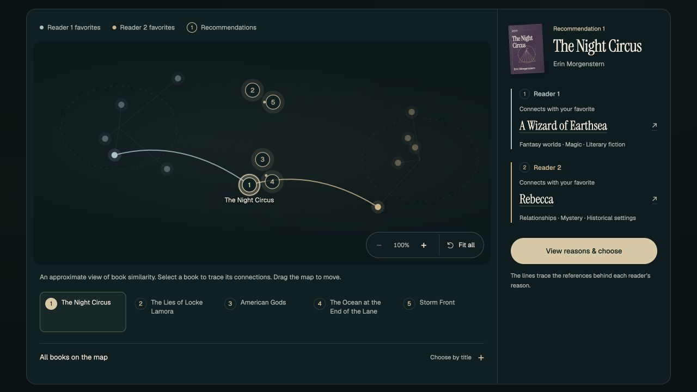
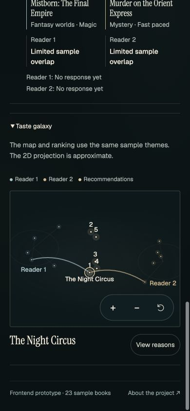
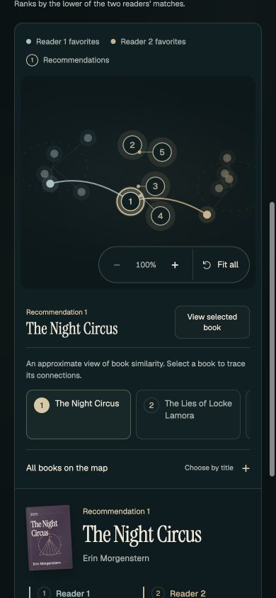
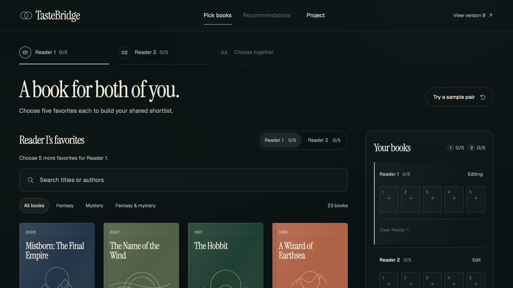
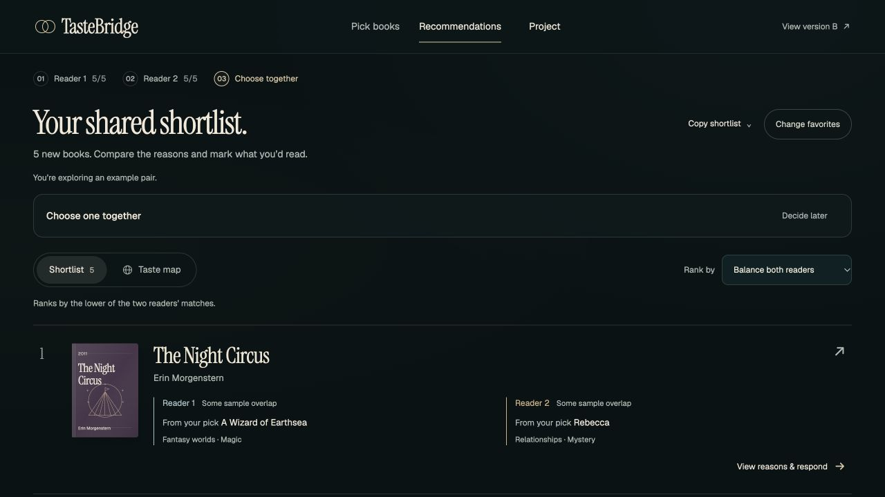

# Reading Desk UI refinement

November 4, 2026 · A release `20261104.1` · branch `jenny/ms3-ui-setup`.

This records the first functional UX pass. The subsequent [design review for release 20261104.2](design-review-20261104.md) contains the current daylight theme and final visual evidence.

## Before → after

| Observed problem | Implemented behavior |
| --- | --- |
| Map buried below five long result cards | Shortlist and Taste map are peer views at the top of recommendations |
| Tiny, overlapping map targets; book information depends on hover | Numbered callouts separate crowded recommendations, with exact location dots and short leaders; all titles are also directly selectable |
| Selecting a star immediately interrupts exploration with a dialog | Selection updates a persistent book inspector; a separate action opens the reasons and decision controls |
| Phone map selection updates content farther down the page | The selected title appears directly below the diagram, with View selected book to reach its context |
| Empty favorite slots look actionable but do nothing | Every empty slot selects the correct reader and brings search into view |
| Connected catalogue starts as an unstructured empty area | A focused search empty state; sample-catalogue author shortcuts; visible clear-search control |
| Cards repeat reader names and similarity in separate blocks | Reference, shared themes and model similarity appear together for each reader, followed by an explicit response action |
| Hydrating a pick allows a reader-step race that leaves controls disabled | Busy steps, reader controls and search are locked; Pick books remains available to cancel |
| Next/Previous can retain the last book's dialog scroll | A different book starts at its title; same-book voting keeps scroll and expanded evidence |
| Returning from results can land halfway down the catalogue | Stage changes return to the top; phone shelf editing exposes search |
| Empty map results and replaced decision buttons can strand recovery/focus | Empty results return to the visible shortlist; focus returns to the active map or list |

The visual direction keeps the existing forest canvas, mist-blue/sand reader identities, original book covers, Instrument Serif and Geist. Quieter controls, consistent spacing and compact evidence give the books and their connections the strongest emphasis. New UI and map styles are isolated in `desk-refinement.css` and `desk-galaxy.css`.

## Visual review

Both map views below use the same offline example pair. The original checkout was served read-only for the before capture.

| Before | After |
| --- | --- |
|  |  |
|  |  |





## Verification

**75 tests pass, 0 failures, 0 skips.** [Full TAP report](ux-refinement-20261104/frontend-tests.tap). All four generated routes pass the inline JavaScript, metadata and navigation check; `git diff --check` passes. Run from `frontend/prototype`:

```sh
node scripts/build-prototype.mjs
node scripts/verify-release.mjs
node --test tools/verify-*.mjs
```

Browser checks use the actual local frontend and API, with bundled model `sample-shelf-toy-v1` and 52 books, plus the independent 23-book offline demo.

| Interaction | Result |
| --- | --- |
| Author shortcut → title search → favorite selection | Tolkien search returns actual API books; The Hobbit is added to Reader 1 |
| No-match search → clear search | Returns to the search starting state while keeping selected favorites |
| Empty shelf slot → reader editing | Selects the intended reader and exposes focused search on a phone |
| Map star/title selection | Inspector updates without opening a modal; exact model coordinates stay intact |
| Favorite reference inside inspector | Traces related recommendations and retains keyboard focus on the replacement heading |
| View selected book on phone | Scrolls/focuses the selected book context only after the explicit action |
| Zoom in → Fit all | Reports 125%, then returns to 100% |
| Keyboard Left/Right on view tabs | Changes views and moves tab focus; current opinions remain |
| Both Interested → confirm | Creates an explicit local joint choice |
| Average reranking with the chosen book retained | Keeps the choice and both reader responses, including updated rank |
| Change a reader response to Pass | Revokes the joint choice and restores exploration |
| Dialog close from map | Focus returns to the visible selected map book |
| Copy shortlist → Show text to copy | Manual copy remains available without relying on clipboard permission |

Responsive checks cover 1280px desktop, 768px tablet, 390px phone and 320px narrow phone; inspected selection, shortlist, map and dialog views have no page horizontal overflow. [Recorded dimensions](ux-refinement-20261104/responsive-checks.json). No browser warning/error entries were observed.

## Review locally

The work was developed in an isolated copy; the original checkout was left unchanged. With the preview server running, use `http://127.0.0.1:4180/a/?api=0`, with the connected sample at `http://127.0.0.1:4180/a/?api=1`. To start the same port configuration again from `frontend/prototype`:

```sh
TASTEBRIDGE_UI_PORT=4180 TASTEBRIDGE_API_PORT=9020 node scripts/dev.mjs
```

Choose Try a sample pair, then switch between Shortlist and Taste map. The current browser tab shows the example pair with no feedback submitted.

## Scope and limits

Backend ranking, artifact formats and returned scores were preserved. Version B and the project-scope page were not restyled. No packages were added. The work remains local and uncommitted; no push, deployment, external message or feedback submission was made.

The trained 5,000-work export is absent locally, and Docker's configured daemon is not running. Browser checks establish frontend behavior against the bundled API, not trained-model quality, production deployment or reader-study outcomes.
